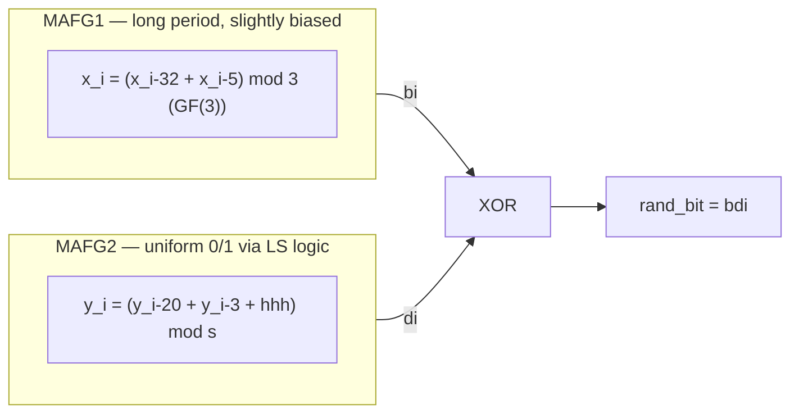
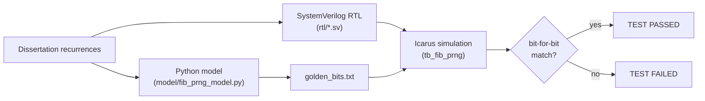

# fib-prng — Complete Guide (start here)

A hardware (SystemVerilog) implementation of the **combined Fibonacci
pseudo-random number generator** from the doctoral dissertation
*"Comparative study of additive and modified Fibonacci generators in the context
of statistical quality"* (P. Sawicki, Opole University of Technology, 2026),
Section 2.3 / 4.3 (the IEEE Access 2025 combined-generator design).

This guide assumes **no prior hardware knowledge**. If you can run `make`, you
can build, test, explore, and inspect this design.

---

## 1. What does this thing do?

It produces a stream of pseudo-random **bits** (0/1) in hardware. You give it a
clock and a seed; every clock cycle it emits one new bit on `rand_bit`.

The trick from the dissertation is to combine **two** Fibonacci generators:



- **MAFG1** uses a primitive polynomial over `GF(3)` (`x^32 + x^5 + 2`). It has a
  guaranteed maximal period `3^32 − 1` for *every* seed (so there are no "weak
  keys"), but because the modulus 3 is odd its raw bit stream `bi` is slightly
  biased (more 0s than 1s).
- **MAFG2** uses the polynomial `y^20 + y^3 + 1` plus a small **logic circuit
  (LS)** that XORs two bits of its first register back into the recurrence. This
  makes its bit stream `di` statistically uniform.
- **XOR** of a biased-but-long stream with a uniform stream is uniform (proven on
  p.39 of the dissertation). So `bdi = bi XOR di` is both long-period and
  uniform — the property the NIST tests reward.

You can verify the uniformity yourself: `make sim` reports a 0/1 ratio near
0.500.

---

## 2. The 30-second quick start

```bash
./scripts/bootstrap.sh   # one-time: installs the tools (Homebrew, iverilog, ...)

make lint                # 1. static analysis / linting
make sim                 # 2. simulate the combined generator (self-checking)
make wave                # 3. open the waveform viewer (Surfer)
make synth               # 4. generic synthesis + gate count (Yosys)
make regress             # run ALL tests, exit non-zero on failure
make explore             # play with the Python reference model
make nist-install        # build the NIST SP 800-22 suite (one-time)
make nist                # statistically test the output (dissertation claim)
make help                # list every target
```

Every command prints what it is doing. `make sim` ends with either
`TEST PASSED` or `TEST FAILED`.

---

## 3. What's in the box (file map)

```
fib-prng/
├── rtl/                      synthesizable SystemVerilog (the actual hardware)
│   ├── mod_add.sv            arbitrary-modulus adder (the "mod m" trick, eq 3.1)
│   ├── mafg.sv               generic (Modified) Additive Fibonacci Generator
│   └── fib_prng.sv           TOP: MAFG1 XOR MAFG2 (the combined generator)
├── tb/                       simulation testbenches (not synthesized)
│   ├── tb_mod_add.sv         exhaustive unit test of mod_add
│   ├── tb_fib_prng.sv        checks the RTL against the golden model, bit-for-bit
│   └── golden_bits.txt       expected "bdi bi di" vectors (from the model)
├── model/
│   └── fib_prng_model.py     Python golden reference model + explorer
├── synth/synth.ys            Yosys generic-synthesis script
├── scripts/
│   ├── bootstrap.sh          one-command environment setup
│   ├── install_nist_sts.sh   build the NIST SP 800-22 suite locally
│   └── run_nist.sh           generate a stream and run the NIST suite
├── Makefile                  all the commands above
├── tools/                    third-party tools built locally, e.g. NIST STS (git-ignored)
├── build/                    generated artifacts (git-ignored)
└── docs/                     this guide + the environment doc
```

Read order for humans: `model/fib_prng_model.py` (easiest) → `rtl/mafg.sv` →
`rtl/fib_prng.sv`.

---

## 4. How the hardware works (a little deeper)

### 4.1 The registers (a shift chain)

Each generator is a chain of small **registers** `RG1..RGN`. Each register holds
one base-`m` "digit". `RG1` is the newest value `y_{i-1}`, `RGN` the oldest
`y_{i-N}`. Every clock:

1. compute `new = (RG[LAG_A] + RG[LAG_B] + a) mod m`,
2. shift everything down (`RGN←RG(N-1)`, …, `RG2←RG1`),
3. put `new` into `RG1`.

The output bit is the least-significant bit of `new`.

### 4.2 The "mod m" trick (`mod_add.sv`)

Dividing in hardware is expensive. The dissertation (eq. 3.1/3.6) avoids it. With
`A = 2^WIDTH − m`:

```
s1 = sum_in mod 2^WIDTH         (just the low bits)   , carry c1
s2 = s1 + A                     (i.e. s1 − m, wrapped) , carry c2
out = (c1==0 && c2==0) ? s1 : s2
```

That is a single conditional subtraction of `m`, which is exactly `sum_in mod m`
for the small sums the Fibonacci recurrence produces. The two carries drive the
OR-gate + multiplexer you see in the dissertation's figures.

### 4.3 The LS logic circuit (`a` term)

For MAFG2, `a = h0 XOR h_k`, where `h0..h_k` are bits of register `RG1`. This is
the `USE_LS`/`LS_TAP_MASK` parameters in `mafg.sv`. MAFG1 sets `USE_LS=0`, so its
`a` is always 0 (a classic AFG).

### 4.4 Interface of the top module (`fib_prng.sv`)

| Signal      | Dir | Meaning                                             |
| ----------- | --- | --------------------------------------------------- |
| `clk`       | in  | clock                                               |
| `rst_n`     | in  | asynchronous, active-low reset (loads default seed) |
| `en`        | in  | advance one step per clock when high                |
| `load`      | in  | load `seed1_in`/`seed2_in` on the next clock        |
| `seed1_in`  | in  | packed seed digits for MAFG1                         |
| `seed2_in`  | in  | packed seed digits for MAFG2                         |
| `rand_bit`  | out | the combined output bit `bdi`                       |
| `bi`, `di`  | out | the individual MAFG1 / MAFG2 bits (for inspection)  |

Key parameters (override at instantiation): `MOD2` (the modulus `s` of MAFG2,
default 8) and `LS2_TAP` (which RG1 bits form `hhh`, default `0b0101` = `h0 ⊕ h2`).

---

## 5. Running things, explained

### 5.1 Lint (catch mistakes without simulating)

```bash
make lint
```

Runs Verilator (`--lint-only -Wall`) and an Icarus syntax check. Ends with
`Lint OK`.

### 5.2 Simulate (prove it behaves correctly)

```bash
make sim                     # top-level combined generator
make sim TB=tb_mod_add       # just the modulo-adder unit test
```

`make sim` compiles the RTL + testbench with Icarus Verilog, runs it, and checks
**every output bit against the Python golden model**. It writes a waveform to
`build/wave/`. Look for `TEST PASSED`.

### 5.3 View waveforms

```bash
make wave                    # runs sim, then opens build/wave/tb_fib_prng.vcd
```

Opens the VCD in **Surfer**. (You can also open `build/wave/*.vcd` with the
Surfer VS Code extension: right-click the file → *Open with Surfer*.) Add
`clk`, `rst_n`, `en`, `bi`, `di`, `rand_bit` to the view to watch the bit stream.

### 5.4 Explore the algorithm (no hardware tools needed)

The Python model is the friendliest way to understand the generator:

```bash
make explore                              # 128 bits + 0/1 statistics
make explore ARGS='-n 1000'               # 1000 bits
python3 model/fib_prng_model.py -n 64     # same, run directly
python3 model/fib_prng_model.py -s 6 --ls2-tap 0b0011   # different MAFG2 modulus
```

It prints the bit stream and the ones/zeros ratio (should hover around 0.5).

### 5.5 Regenerate golden vectors (after changing parameters)

The testbench compares against `tb/golden_bits.txt`. If you change RTL
parameters, regenerate it with matching model parameters:

```bash
make golden                                       # default s=8, tap 0b0101
make golden MODEL_ARGS='-s 6 --ls2-tap 0b0011'    # keep model and RTL in sync
```

### 5.6 Synthesize (turn RTL into gates, estimate size)

```bash
make synth
```

Runs Yosys generic (technology-independent) synthesis and prints a gate/flip-flop
count to `build/synth/stats.txt`. Expected for the defaults: ~124 flip-flops
(MAFG1 = 32 registers × 2 bits + MAFG2 = 20 registers × 3 bits). This is an
estimate only — no FPGA/ASIC vendor flow is involved (out of scope).

### 5.7 Run everything

```bash
make regress     # all testbenches; non-zero exit on any failure (CI-friendly)
make all         # lint + regress + synth
make clean       # delete build/
```

### 5.8 Statistically test the output (NIST SP 800-22)

This is the test that reproduces the **dissertation's headline claim** — that the
combined generator passes the NIST suite. It is opt-in (not part of `make
regress`) because it needs an external suite and processes a lot of bits.

```bash
make nist-install         # one-time: build the NIST STS suite locally
make nist                 # assess the PRNG (default 100 streams x 1,000,000 bits)
make nist NIST_ITER=1000  # the full dissertation config (10^9 bits, ~10 min)
```

What happens: [scripts/run_nist.sh](../scripts/run_nist.sh) generates a raw
binary bit stream from the reference model and runs all 15 NIST tests on it,
writing a human-readable summary to `build/nist/result.txt`.

Why testing the *model* is enough: `tb_fib_prng` proves the RTL is **bit-for-bit
identical** to the model, so a NIST result on the model characterises the
hardware output too (see §6).

Configuration knobs (Make variables):

| Variable       | Default     | Meaning                                  |
| -------------- | ----------- | ---------------------------------------- |
| `NIST_ITER`    | `100`       | number of bitstreams (dissertation: 1000)|
| `NIST_BITS`    | `1000000`   | bits per bitstream                       |
| `NIST_MOD2`    | `8`         | MAFG2 modulus `s`                        |
| `NIST_LS2_TAP` | `0b0101`    | MAFG2 LS tap mask (`h0 ⊕ h2`)            |

Reading the result: a line such as `188/188 tests passed` means full success.
With few streams (e.g. `NIST_ITER=100`) it is normal for one or two of the 188
sub-tests to be flagged on the *proportion* analysis — roughly 1% of tests are
expected to fall outside the confidence interval by chance. Increasing
`NIST_ITER` toward the dissertation's 1000 stabilises the pass rate.

Prefer a quick smoke check instead of the full suite? `dieharder -g 201 -a` on a
generated stream also works (`brew install dieharder`).

---

## 6. How correctness is guaranteed



The Python model and the RTL are independent implementations of the same
equations. The testbench replays 2000 golden bits through the RTL and fails on
the first mismatch, so any divergence is caught immediately. The same model
feeds the NIST statistical suite (§5.8), so the hardware inherits the verified
statistical quality.

---

## 7. Common tweaks

| I want to…                          | Do this                                                        |
| ----------------------------------- | ------------------------------------------------------------- |
| Change MAFG2 modulus `s`            | set `MOD2` param on `fib_prng`; `make golden MODEL_ARGS='-s N'`|
| Change the LS taps (`hhh`)          | set `LS2_TAP` param; regenerate golden with `--ls2-tap`       |
| Seed the generator explicitly       | drive `seed1_in`/`seed2_in`, pulse `load` high for one clock  |
| Run only the adder test             | `make sim TB=tb_mod_add`                                       |
| Statistically test the output       | `make nist-install` then `make nist`                          |
| Use GTKWave instead of Surfer       | `make wave WAVE=/path/to/gtkwave`                              |

---

## 8. Troubleshooting

| Symptom                                   | Fix                                                          |
| ----------------------------------------- | ----------------------------------------------------------- |
| `command not found: iverilog/yosys/...`   | run `./scripts/bootstrap.sh`                                 |
| `TEST FAILED` after changing a parameter  | regenerate golden vectors (`make golden` with matching args)|
| `cannot open golden file`                 | run from the repo root, or `make golden` first              |
| Surfer window doesn't open                 | open `build/wave/*.vcd` via the Surfer VS Code extension     |
| `NIST STS not found at tools/...`         | run `make nist-install` first                               |
| `fftw3.h file not found` when building STS | `brew install fftw`, then `make nist-install`               |

---

## 9. What is intentionally NOT here

RTL only. No Vivado/Quartus/Libero projects, no ASIC place-and-route, no timing
closure, no power optimization, no technology-library synthesis. Those can be
added later by third parties **without changing the RTL**. See
[DEV_ENVIRONMENT.md](DEV_ENVIRONMENT.md) for the full toolchain and rationale.

---

## 10. Reproducing the dissertation's statistical claim

The dissertation's central result is that the combined generator passes the full
NIST SP 800-22 suite. This repository reproduces that end to end:

1. `make nist-install` builds the NIST STS suite locally (the actively-maintained
   [arcetri/sts](https://github.com/arcetri/sts) fork — same tests, non-interactive
   CLI; FFTW is its only extra dependency and is installed automatically).
2. `make nist` generates a bit stream from the reference model and runs all 15
   tests, writing `build/nist/result.txt`.
3. For the exact dissertation configuration use 1000 streams of 1,000,000 bits:

   ```bash
   make nist NIST_ITER=1000        # 10^9 bits, ~10 minutes
   ```

Because the RTL is verified bit-exact against the model (§6), this NIST result
applies to the hardware output as well. The generator logic — not a proprietary
test harness — is what is being validated, so the result is reproducible on any
clean macOS install via `./scripts/bootstrap.sh`.

> Scope note: the NIST suite is built from source into `tools/` (git-ignored),
> not vendored into the repository. Statistical testing operates on the bit
> **sequence**, so it runs against the fast reference-model stream rather than an
> HDL simulation — which is why it can afford 10^9 bits.
